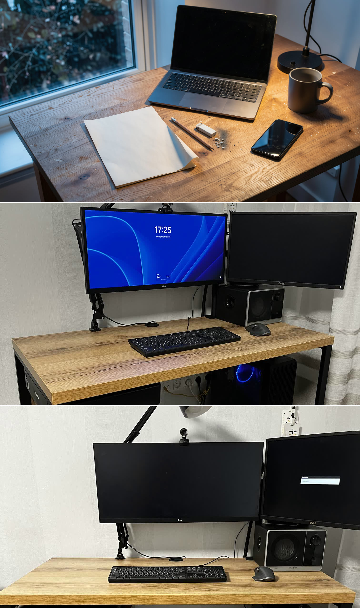

# Стіл для першого екрана: згенерований чи власний

**Рішення 25.11.2026: лишаємо згенерований стіл (варіант а).** Кадри K1, K2, K5, виміри в `geometry.js` і каркас не змінюються. Тестові кадри T0–T2 не робили, кредити не витрачали (на рахунку 983). Решта нотатки — на випадок, якщо до питання повернемося.

Нотатка від 25.11.2026. Порівняння зроблено на трьох фото справжнього столу (збоку з вимкненими моніторами, збоку із заставкою Windows, спереду) і погоджених кадрах K1, K2, K5 (`frames/test/k1-flux-open-laptop.png`, `k2-flux-sketch-no-letters.png`, `k5-flux-hand-b.png`).

`desk-options-compare.jpg`: згори K1, під ним два фото столу, обрізані до формату сцени 16:9 за повною шириною.

## Що видно на фото

- **Формат.** Фото вертикальні, 1512 × 2016. Обрізка 16:9 на всю ширину дає 1512 × 850, а кадр сцени має 2736 × 1536, тобто в 1,8 раза більше. Під час наїзду екран збільшується ще в кілька разів.
- **Ракурс.** Знято стоячи, здалеку, видно весь стіл до підлоги. Стільниця в кадрі 16:9 — вузька смуга перед клавіатурою. Аркуш, головний предмет K1–K2, там не вміститься великим: ескіз буде дрібний.
- **Світло.** Денне, рівне, без тіней (на заставці 17:25, травень). Сцена задумана вечірньою, бо тоді накладений HTML виглядає як справжнє світло екрана.
- **Предмети.** Два монітори (ультраширокий LG 21:9 і Dell 16:9), колонки, вебкамера, клавіатура, миша. Під стільницею розетки, кабелі, принтер і системний блок із синім підсвічуванням. Немає аркуша, олівця, телефона, чашки.
- **Логотипи:** LG і Dell на рамках, Microlab на колонці, вебкамера, Canon і Zalman під стільницею.
- **Стільниця** — новий світлий ламінат «під дуб», чистий, без подряпин. Згенерований стіл подобається саме фактурою: подряпини, вм'ятини, графітовий пил.

## Варіанти

### (а) Лишити згенерований стіл

**Плюси**
- Усе вже погоджено й працює: K1, K2, K5, виміряні кути, каркас.
- Поза ділянкою правки FLUX тримає кадри піксель у піксель (PSNR inf). Тому прояв ескізу маскою й одна `matrix3d` на весь сюжет працюють без підгонки.
- Настрій, який вибрали 25.11: вечір, вікно, подряпаний дуб, «справжнє фото, а не сток».
- Композиція зроблена під сюжет: аркуш великий на передньому плані, один екран, телефон під рукою.
- Додатково не витрачаємо жодного кредиту.

**Мінуси**
- Це не твій стіл. Ноутбук схожий на MacBook, сцена загальна.
- Коли хтось запитає «це твоє робоче місце?», чесна відповідь — «згенероване».

### (б) Нова серія, твій стіл як референс стилю

**Плюси**
- Ракурс, світло й композицію тримаємо самі, як зараз.
- Упізнавані деталі: дубова стільниця, чорна рама, лампа на кронштейні, ультраширокий LG.

**Мінуси**
- Вийде схожий стіл, а не твій. Особиста історія зводиться до «схожий на мій», а переробляти треба все.
- K1 доведеться генерувати з нуля, без готового кадру-основи. Ланцюжок «правка лише ділянки» починається тільки з K1, тож на пошуки вдалої основи підуть кілька спроб.
- Чистий новий ламінат, два монітори й колонки тягнуть до «сетап-фото» з каталогу. Саме таку вилизаність ми відкинули 25.11.
- Твій стіл не дає того, що тримає сцену: подряпаної фактури, вікна, пустого місця під аркуш.

### (в) Твоє фото як основа K1, далі правки FLUX

**Плюси**
- Найчесніше: справжній стіл і справжнє фото.

**Мінуси (для цих трьох фото)**
- Перевести денне світло у вечірнє FLUX може, лише перемалювавши весь кадр. Тоді від фото лишається тільки план, а решту вигадує модель, тобто виходить той самий варіант (б), тільки з гіршого старту.
- Ракурс не той, і його правкою не виправиш. Камера стоїть здалеку й високо, стільниця — смуга, а під нею розетки, кабелі й системний блок.
- Роздільність: 1512 px завширшки замість 2736. Модель домальовує деталі, і для наїзду рамка монітора виходить м'якою.
- Шість логотипів: кожен треба прибрати правкою або ставити в промпт.

### (г) Перезняти свій стіл: справжня серія зі штатива

Цей варіант я додав сам: для «свого столу» він кращий за (б) і (в).

**Плюси**
- Справжній стіл, справжній ескіз (у `storyboard.md` уже сказано, що твій ескіз кращий за ШІ), справжня рука з телефоном. Найризикованіша для ШІ частина, рука, стає найпростішою.
- Кадри зі штатива збігаються піксель у піксель самі по собі, якщо зафіксувати експозицію й фокус. Це те саме, що дає FLUX.
- Сильний аргумент проти «ШІ-шаблонності», якою відгонять конкурентні портфоліо: «це мій стіл і мій ескіз, а сайт усередині — мій код».
- Майже безкоштовно: 0–9 кредитів, гроші йдуть хіба що на прибирання логотипів, а логотипи можна просто заклеїти.

**Мінуси**
- Потрібен вечір на зйомку і штатив або хоча б стос книжок плюс таймер.
- Якість залежить від телефона. Увечері буде шум, але шум якраз виглядає як справжнє фото.
- Сцена буде інша: вікно праворуч за шторою, лампа ліворуч, стіна з шпалерами. Настрій «студії» доведеться ловити світлом, а не генерацією.
- Відео V1 і V3 однаково робимо в Higgsfield, з цих кадрів як першого й останнього. Або зовсім без відео: V1 вже замінено маскою.

## Монітор як ціль наїзду

Майже фронтальний LG справді дає чисте накладення: кути майже прямі, HTML найрізкіший. Але є дві заковики.

1. **Пропорції.** LG має 21:9 (≈ 2,37 : 1), а вікно браузера зазвичай 16:9 (1,78) або 16:10 (1,6). `HeroScene.vue` дає екрану, в який наїжджаємо, розмір вікна й натягує його на 4 кути (`rectToQuad`). На 21:9 HTML на моніторі розтягнеться по горизонталі на 33–48 %, а під час наїзду все фото стиснеться з боків. Розв'язок природний: на ультраширокому моніторі браузер рідко розгортають на весь екран. Ціль наїзду — вікно браузера 16:9 по центру монітора, а його 4 кути рахуємо через гомографію екрана. Це невелика правка в `HeroScene.vue` і `geometry.js`, але її треба зробити.
2. **Ефект наїзду.** У фронтального екрана ефекту «камера розвертається до екрана» майже немає, наїзд виглядає як просте збільшення. Косий ноутбук дає цей поворот задарма.

Dell має 16:9, але стоїть з краю й навскіс, тож теж не ідеальний.

## Що переробляти, якщо міняємо стіл

| Що | (б) генерація | (в) твоє фото + FLUX | (г) перезйомка |
|---|---|---|---|
| K1 | 2–4 спроби × 3 = 6–12 кр | 1–3 спроби × 3 = 3–9 кр + прибирання логотипів 3–6 кр | 0 кр (заклеїти логотипи) або 3 кр |
| K2 | 1–2 × 3 = 3–6 кр | 1–2 × 3 = 3–6 кр | 0 кр, твій ескіз |
| Кадр зі світлим екраном для виміру | 3 кр | 3 кр | 0 кр, білий екран на моніторі |
| K5 (рука з телефоном) | 2 варіанти × 3 = 6 кр | 6 кр | 0 кр, твоя рука |
| Збільшення для наїзду | можливо, `upscale_image` | майже напевно `upscale_image` | ні, якщо знімати в повній роздільності |
| **Разом кредитів** | **≈ 18–27** | **≈ 18–30 + upscale** | **0–9** |

Однаково для всіх трьох:
- `npm run measure`: заново кути екрана (`diff` між вимкненим і ввімкненим екраном або `bright` на білому) і кути телефона (`bright` на K5).
- `src/scene/geometry.js`: `LAPTOP` (стане монітором), `PHONE`, `SHEET` (вручну), `FOCUS` (три точки панорами для телефонів), `GLOW` (де лежить світло екрана), можливо `DESIGN.laptop`. `FRAME` лишається 2736 × 1536, якщо зводити кадри до цього розміру.
- `scripts/build-frames.mjs`: нові шляхи до кадрів, потім `npm run frames`.
- Якщо ціль — ультраширокий LG, то правка наїзду у вікно 16:9 (див. вище).
- `docs/storyboard.md`: переписати «Сцену» й промпти.
- Відео V1 і V3 ще не генерували, тож нічого не втрачаємо.
- Час: зйомка — вечір (г) або година генерацій (б, в). Плюс 1–2 години на виміри й перевірку в каркасі.

## Рекомендація

**Перший екран лишаємо на згенерованому столі (а).** Він уже погоджений, сцена зібрана під сюжет, а відвідувач однаково не знає, чий це стіл. Варіанти (б) і (в) з цих фото забирають усю роботу заново, а особистої історії майже не дають: з'являється схожий стіл, але не твій.

**Якщо хочеться саме свій стіл — тільки перезйомка (г).** Там особиста історія справжня, а не намальована. Почати варто з безкоштовного тестового кадру (список нижче). Якщо він вийде, вирішимо, чи переходити.

Окрема дешева ідея: справжнє фото столу в блок «Про себе» («тут це все й робиться»). Перший екран тоді не чіпаємо.

## Тестові кадри — лише після «так»

| Тест | Що | Ціна | Файл |
|---|---|---|---|
| T1 (варіант в) | FLUX-правка твого фото збоку, обрізаного до 16:9: вечір, лампа світить, без логотипів, чистий аркуш, олівець і телефон перед клавіатурою | 3 кр | `frames/test/k1-own-desk-test.png` |
| T2 (варіант б) | FLUX з твоїм фото як референсом, ракурс і світло як у K1: косо з лівого переднього кута, близько, вечір | 3 кр | `frames/test/k1-own-desk-style-test.png` |
| T0 (варіант г) | Твій кадр за списком нижче, я перевіряю, чи він годиться для сцени | 0 кр | `frames/test/k1-own-desk-photo.jpg` |

На рахунку 983 кредити (перевірено 25.11), flux_3_image 2k 16:9 — 3 кредити за кадр.

### Список для зйомки T0

- Горизонтально, основна камера 1×, найвища якість. Телефон на штативі або на стосі книжок, між кадрами його не чіпати. Довге натискання на екран фіксує експозицію й фокус. Знімати таймером 3–10 с.
- Вечір: верхнє світло вимкнене, лампа ввімкнена й опущена до стільниці. Штора трохи відкрита в синю годину або вже в темряву.
- Ракурс: з лівого переднього кута, камера над стільницею під 45–50°, близько. Стільниця займає нижні дві третини кадру, LG повністю в кадрі, нічого з-під стільниці в кадр не потрапляє.
- На столі: аркуш A4 вертикально перед клавіатурою (кути закріпити шматочками скотчу, щоб не зсунувся), олівець, гумка, телефон екраном догори праворуч, чашка. Зайве прибрати.
- Логотипи LG, Dell, Microlab і вебкамери заклеїти чорною матовою ізострічкою або зняти так, щоб їх не було видно.
- Для тесту досить одного кадру: чистий аркуш, монітор вимкнений. Якщо підемо далі, до нього додаються: кадр із білим екраном (для виміру), кадр з ескізом на тому ж аркуші, кадр з телефоном у руці.
