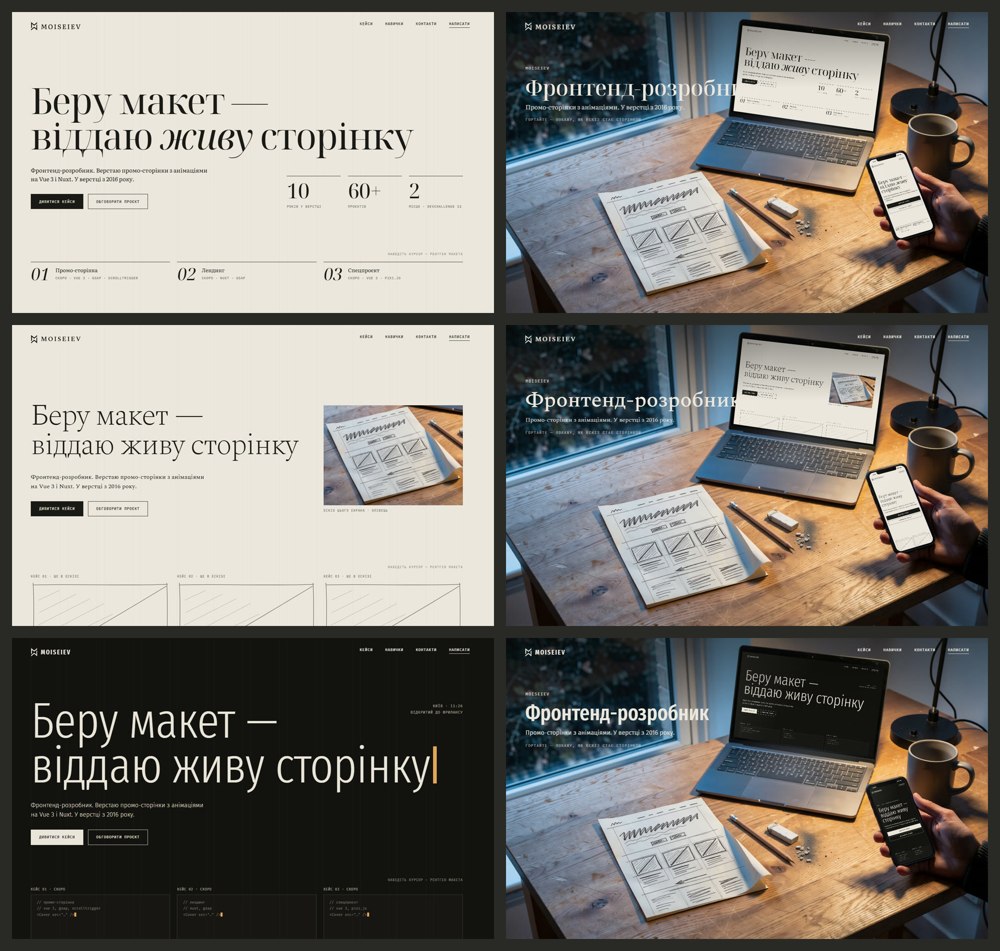
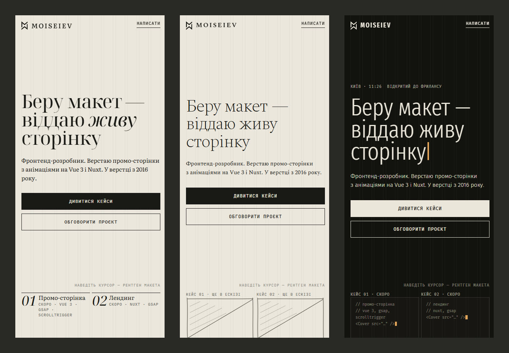

# Вигляд внутрішнього першого екрана: три варіанти

Нотатка від 26.11.2026. Поточний `SiteHero.vue` — робочий каркас: тимчасові шрифти, порожня права половина й перекреслені рамки кейсів, які виглядають як сирий вайрфрейм. Варіанти зберігають компонування ескізу на аркуші (K2): лого й навігація, заголовок у два рядки, підзаголовок, дві кнопки, три картки внизу. Тому кадри генерувати заново не треба.

Ширший пошук стилю за межами брифу (креслення, кіно, плакат, сирий HTML) — у [style-search.md](style-search.md).

## Як подивитися

Варіант вмикається параметром в адресі, разом з усією сценою:
- `http://localhost:5173/?look=a`, `?look=b`, `?look=c`
- `&calm` — спокійна версія (фото, під ним сторінка), `&p=1` — кінець наїзду.

Без параметра лишається поточний вигляд. Перемикач — `src/lib/look.js`. Шрифти й кольори задано в `base.css` (`:root[data-look=…]`), розкладку — у кінці стилів `SiteHero.vue`.

## (а) «Редакція»

- **Шрифти:** Noto Serif Display (заголовки, висококонтрастна антиква) · Literata (текст) · IBM Plex Mono (підписи).
- Слово «живу» набрано курсивом.
- **Права половина:** три факти під заголовком: 10 років у верстці, 60+ проєктів, 2-ге місце на DevChallenge 11 (зі старого сайту). Роки рахуються від 2016.
- **Кейси:** замість порожніх рамок — рядок «змісту»: великий номер курсивом, тип сторінки, «скоро» й стек. Коли в кейса з'явиться обкладинка, на її місці буде картинка.
- Висококонтрастна антиква розсипається в дрібному розмірі, тому лого й рядки кейсів набрані Literata.
- **Мінуси:** на телефоні фактів немає, бо по висоті не вміщаються.

## (б) «Ескіз поруч»

- **Шрифти:** Spectral (і заголовки, і текст; у заголовку тонке накреслення 200) · JetBrains Mono.
- **Права половина:** справжнє фото ескізу цього екрана (`frames/sketch/sheet.webp`) з підписом. На ноутбуці у фото виходить «фото у фото»: сторінка показує аркуш, який лежить поруч на столі.
- **Кейси:** незроблені кейси «ще в ескізі»: рамка з діагоналлю й штрихуванням олівцем, як на аркуші.
- **Мінуси:** фото повторює сцену, яку щойно прогорнули. Рамки кейсів гарніші, але все одно порожні. На телефоні фото немає.

## (в) «Ніч»

- **Шрифти:** Fira Sans Extra Condensed (великий вузький гротеск) · Fira Sans · Fira Mono.
- **Кольори:** темне тло, теплий світлий текст, один акцент — бурштин лампи (`#e3a55a`).
- **Деталі:** у кінці заголовка блимає каретка редактора. Праворуч — час у Києві наживо і «Відкритий до фрилансу» (формулювання тимчасове).
- **Кейси:** незроблені кейси «ще в коді»: коментар з типом і стеком, `<Cover src="…" />` і каретка.
- У вечірній сцені темний екран ноутбука виглядає найприродніше.
- **Мінуси:**
  - Обриває лінію «папір → сторінка на папері».
  - Вузький гротеск ближчий до того, чого бриф не хоче.
  - Папір і чорнило міняються місцями на всьому сайті. Тонкі лінії в кейсах і на сторінці кейса задані старим кольором чорнила й на темному майже зникають, тож потрібен окремий прохід по кольорах.

## Що зробити після вибору

- Лишити один варіант, прибрати `look.js`, інші правила й зайві шрифти з `index.html`.
- Оновити код, який друкується в редакторі (`hero-code.js`), і праву панель Figma (`ScreenFigma.vue`: назви шрифтів і кольори).
- Шрифти завантажувати з власного сервера, а не з Google Fonts.
