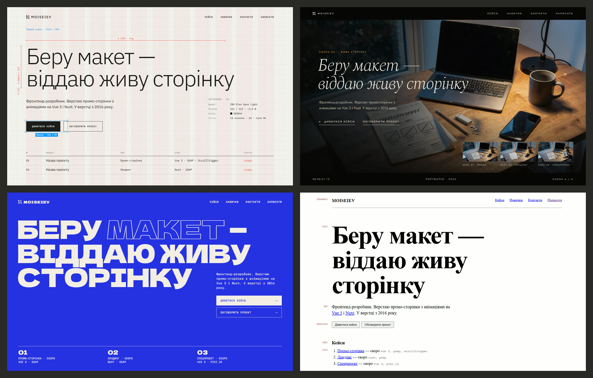
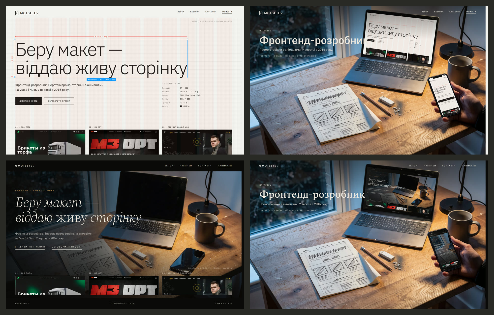
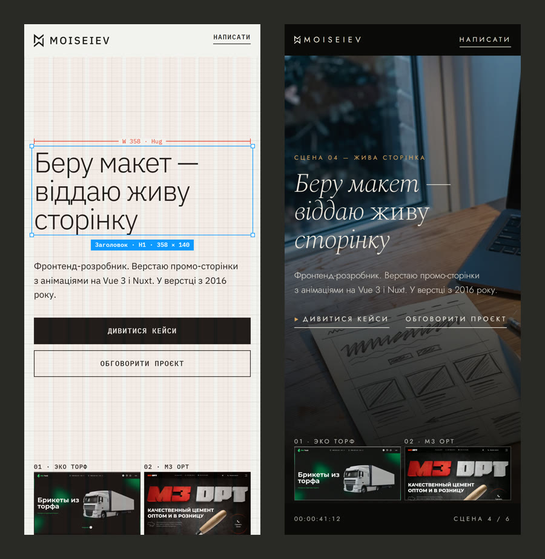
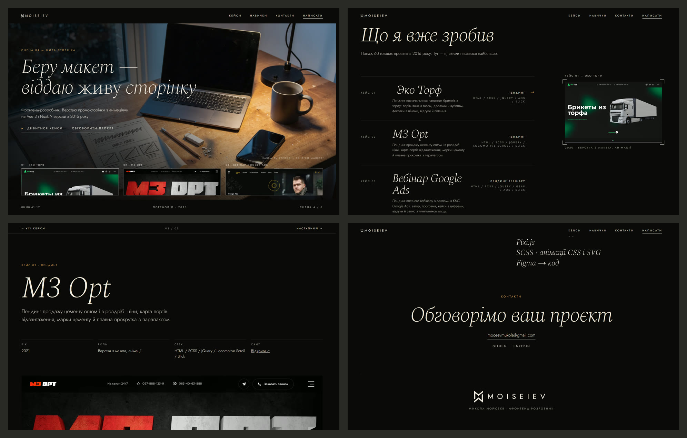
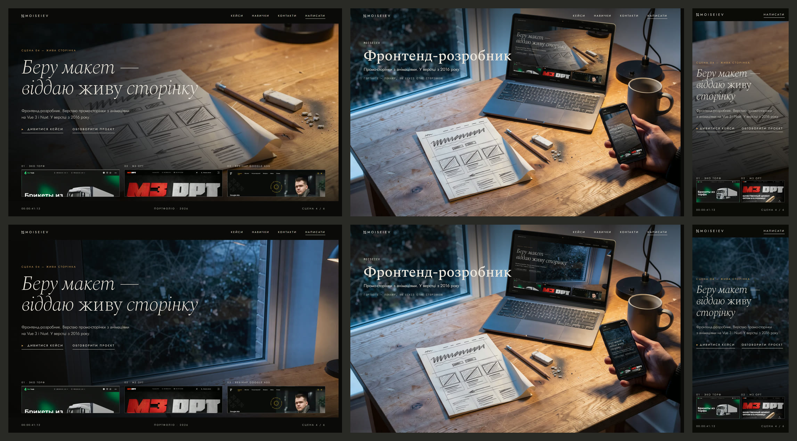
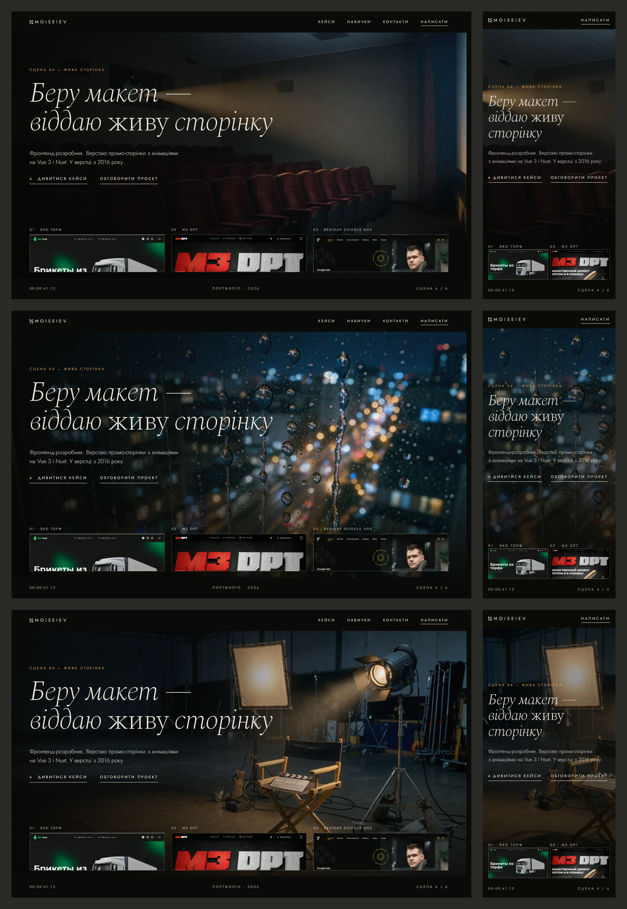
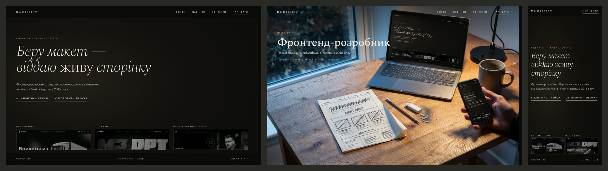
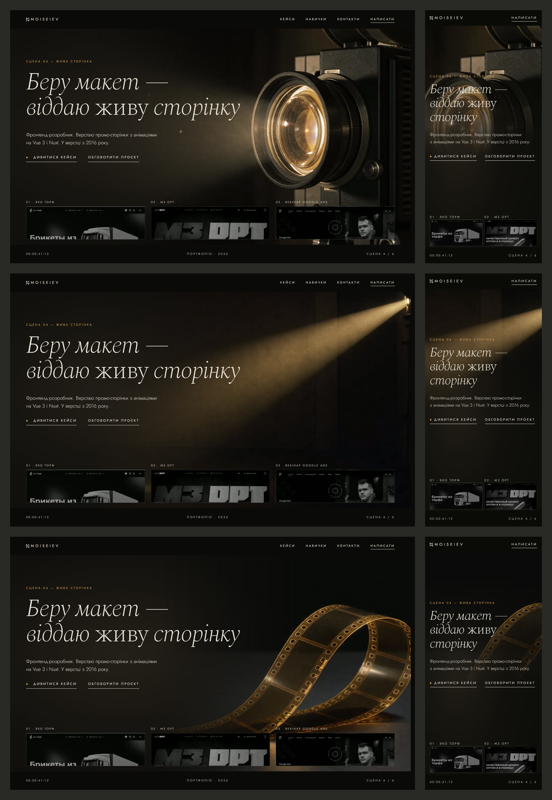
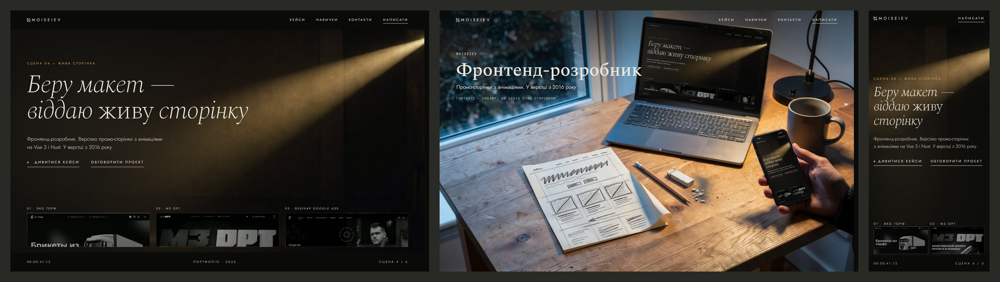
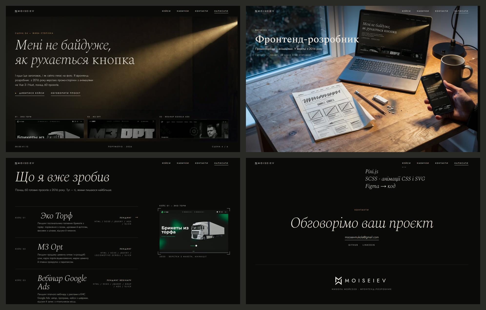

# Стиль сторінки: ширший пошук

Задача від 26.11.2026. Стриману редакційну типографіку в брифі заклали як гіпотезу, а не як рішення. Тож стиль самої сторінки ще відкритий: це перший екран після наїзду, кейси, контакти й сторінка кейса. Сцену «від ескізу до коду» з фото, прокруткою й наїздом у будь-якому разі лишаємо. Питання лише в тому, яким буде сайт, у який ми «заходимо».

Уже є три варіанти з однієї родини, вони вмикаються в коді через `?look=a|b|c` ([look-options.md](look-options.md)):
- (а) «Редакція» і (б) «Ескіз поруч» — світлий журнал з антиквою;
- (в) «Ніч» — темна версія з вузьким гротеском.

Нижче чотири зовсім інші напрями. Кожен показано одним статичним кадром першого екрана, 1440 × 900, з тими самими текстами. Макети лежать у `docs/style-search/*.html`, і їх можна відкрити просто в браузері. Шрифти беремо з Google Fonts; у кожного перевірено, що є кирилиця.

## 1. «Креслення» — `drafting.html`

**Ідея.** Сторінка показує, з чого вона зроблена, як креслення або панель Inspect у Figma: міліметрівка, червоні розмірні лінії, рамка виділення з розміром, панель з назвою шрифту, кеглем і сіткою. Кейси подано таблицею специфікації.

- **Шрифти:** IBM Plex Sans Light, IBM Plex Mono.
- **Рух:** розмірні лінії «вимірюють» елемент, коли той з'являється. Рамка виділення переходить з елемента на елемент, як у главі з Figma.
- **Плюси:** найпряміше говорить «з макета в код» і «я точний». Для верстальника виглядає своїм і не схоже на шаблон.
- **Мінуси:** пасхалка «рентген» стає зайвою, бо сторінка вже її показує. Можна вивернути навпаки: під лінзою видно чисту готову сторінку без креслення. Клієнтам, далеким від розробки, може здатися технічно й холодно.

## 2. «Кіно» — `cinema.html`

**Ідея.** Після наїзду ми не виходимо з фото: сторінка лишається кадром із фільму. Кіноформат (чорні смуги згори й знизу), титри, номер сцени, таймкод; кейси подано як кадри наступних сцен.

- **Шрифти:** Spectral ExtraLight Italic, Jost.
- **Рух:** кадри змінюються під прокрутку, як у сцені; таймкод біжить; кейси відкриваються як перехід між сценами.
- **Плюси:** найплавніше продовжує фотореалізм — немає різкого переходу від фото до плаского сайту. Найбільше «вау» для замовника промо.
- **Мінуси:**
  - Кожен кейс потребує кадрів рівня Higgsfield, а це кредити й час.
  - Текст на фото гірше читається.
  - Сторінка важча (≈200–350 КБ на кадр).
  - Легко скотитися в пафос.

## 3. «Плакат» — `poster.html`

**Ідея.** Головна картинка — сама типографіка. Великий жирний гротеск на один насичений колір (ультрамарин). «МАКЕТ» намальовано контуром, як каркас, а «ЖИВУ СТОРІНКУ» — суцільним. Під прокрутку контур заливається.

- **Шрифти:** Dela Gothic One, Martian Mono.
- **Рух:** кінетична типографіка — літери збираються з рамок макета, а заливка йде під прокрутку. Найкраще показує саме анімацію, головний скіл.
- **Плюси:** запам'ятовується з першої секунди. Контрастує з теплим фото так сильно, що сам наїзд стає подією.
- **Мінуси:** дуже гучно. Один колір мусить витягнути весь сайт. Кейси мають бути не слабші за обкладинку, інакше сторінка «здувається».

## 4. «Сирий HTML» — `raw.html`

**Ідея.** Сторінка навмисно на стилях браузера: Times, сині підкреслені посилання, сірі системні кнопки, а на полях назви тегів, як у devtools. Уся краса в сцені з фото, а сайт — «код як він є».

- **Шрифти:** системні.
- **Рух:** майже нема. Хіба що теги на полях підсвічуються, коли наводиш на елемент.
- **Плюси:** дотепно й чесно. Розробники й студії оцінять жарт.
- **Мінуси:** звичайний замовник прочитає це як недороблений сайт — саме те, чого бриф боїться найбільше («сирі макети»). Для пошуку замовників ризиковано.

## Як вибирати

Кілька питань, які звужують вибір:

1. **Кому сайт продає?** Дизайн-студіям і агенціям, яким потрібен верстальник під їхній макет, — тоді «Креслення» або «Сирий HTML». Прямим замовникам промо — тоді «Кіно» або «Плакат».
2. **Що показувати першим?** Точність верстки — «Креслення», «Редакція». Анімацію — «Плакат», «Кіно».
3. **Світле чи темне?** Сцена вечірня й темна. Світла сторінка дає контраст «увімкнули світло», темна — безшовне продовження.
4. **Наскільки сміливо?** «Редакція» і «Креслення» спокійні, «Кіно» і «Плакат» гучні.

## Наступний крок

Вибрати 1–2 напрями, які чіпляють. Їх варто зробити в коді як `?look=…`, разом з анімацією й сценою, бо статичний кадр не показує головного — руху. Напрями можна й поєднувати, наприклад «Креслення» на першому екрані і «Кіно» в кейсах.

## «Креслення» і «Кіно» в коді (26.11)

Вибрали ці два. Обидва працюють у справжній сцені: на ноутбуці, на телефоні, у Figma й на сторінці після наїзду.
- `http://localhost:5173/?look=drafting`
- `http://localhost:5173/?look=cinema`

Додайте `&calm`, щоб побачити фото й сторінку під ним без анімації, або `&p=1`, щоб одразу потрапити в кінець наїзду.

**«Креслення»** (`DraftMarks.vue` і стилі `.hero--drafting` у `SiteHero.vue`):
- **Тло і шрифти:** міліметрівка, червоні колонки сітки, IBM Plex Sans Light і IBM Plex Mono.
- **Сторінка вимірює сама себе.** Червоні розмірні лінії показують ширину й висоту елемента, синя рамка виділення з кутовими маркерами підписує його розмір. Розміри не вигадані: вони виміряні з верстки (`offsetWidth` тощо), тож на іншій ширині вікна числа інші.
- **Панель Inspect праворуч** показує позицію, розмір, шрифт, кегль, трекінг і колір вибраного елемента. Значення читаються з `getComputedStyle`.
- **Рух.** Виділення переходить заголовок → текст → кнопки → кейси кожні 3,2 с, лінії й рамка плавно перетікають. Якщо навести курсор на елемент, виділення йде за ним. Вгорі праворуч підказка: «Наведіть на елемент — покажу розміри».
- **Копії на екранах.** На ноутбуці й телефоні у фото лишаються лише лінії на заголовку, без рамки виділення: у главі Figma рамка вже є своя.
- **Рентген** у цьому стилі вимкнено, бо сторінка й так показує, з чого зроблена. Якщо стиль залишиться, рентген можна вивернути: під лінзою — чиста сторінка без креслення.
- **Кейс без обкладинки** показано як перекреслену рамку з підписом «Зображення · 16:10»: так на кресленні позначають місце під картинку.

**«Кіно»** (стилі `.hero--cinema` у `SiteHero.vue`):
- **Кадр.** Після наїзду сторінка лишається кадром: чорні смуги згори й знизу, фото столу (кадр K2 з ескізом), затемнене зліва під текстом.
- **Шрифти:** Spectral ExtraLight Italic у заголовку, Jost розрядкою в титрах і навігації.
- **Рух.** Фото повільно наїжджає (28 с туди й назад), по ньому біжить зерно плівки. Унизу таймкод іде наживо, 24 кадри за секунду.
- **Кнопки** стали підкресленими титрами, перед першою — значок ▶.
- **Кейси** — кадри наступних сцен. Кейс без обкладинки показано як хлопавку: «Сцена 05 · Дубль 1 · Зйомка скоро».
- **Кольори.** Як у «Ночі», папір і чорнило міняються місцями на всьому сайті, тож кейси й сторінку кейса ще треба пройти по кольорах.

**Рішення 26.11: «Кіно».** «Креслення» гарне, але людям поза дизайном (HR, замовникам) стиль Figma нічого не скаже, а кіно зрозуміле всім. «Кіно» тепер є на всьому сайті:

- **Кейси** (`CasesSection.vue`) подано як наступні сцени. Номер — «Кейс 01» розрядкою, назви — тонкий курсив Spectral. Прев'ю праворуч тепер не рамка виділення Figma, а видошукач камери: кутові дужки й підпис титрами (`CaseMedia.vue`).
- **Про мене, навички й контакти** (`ContactSection.vue`) зверстано як фінальні титри. Одна колонка посередині: ліворуч бурштиновим — роль («Про мене», «Навички»), праворуч — зміст. Найбільша картка — «Обговорімо ваш проєкт» з поштою. Завершує все лого посередині, як заставка студії. Секція темна, тому її `data-tone` залежить від стилю.
- **Сторінка кейса** (`CasePage.vue`) — картка фільму: назва тонким курсивом, тип бурштином, дані (рік, роль, стек, сайт) титрами.
- **Кольори ліній.** У кейсах, контактах і на сторінці кейса лінії задано через `color-mix` від `var(--ink)` і `var(--paper)`, а не фіксованими `rgba`. Тож вони правильні в будь-якому стилі, а у звичайному вигляді не змінилися.
- **Що лишилося від Figma.** У сцені прокрутки є глава «макет у Figma». Це частина історії «ескіз → макет → код → живе», і підписи її пояснюють, тож для HR вона зрозуміла. Решта сайту про Figma не говорить.

**Без рентгена й без «ноутбука в ноутбуці» (26.11).**
- **Рентген.** Лінза-рентген у «Кіно» вимкнена, бо до теми не пасує (`NO_XRAY` у `SiteHero.vue`). У «Кресленні» вона теж вимкнена. Коли «Кіно» стане основним, `XrayLens.vue` можна прибрати зовсім.
- **Фон першого екрана.** Раніше тлом був кадр K2. Після наїзду в ноутбук на сторінці знову з'являвся стіл з ноутбуком, тож вийшла тавтологія. Згенерували два нові кадри Higgsfield без пристроїв: `flux_3_image`, K2 як референс, по 2 кредити, 1360 × 768, на рахунку 966.
  - `&bg=sketch` (типово) — ескіз крупно: аркуш з олівцем у світлі лампи. Продовжує історію «беру макет». Файл `frames/test/cinema-bg-sketch.png`, job `4490ba98-c216-4fcc-87a4-d8db87887c63`.
  - `&bg=window` — вікно тієї ж кімнати в сині сутінки. Спокійніше, і текст на ньому читається краще. Файл `frames/test/cinema-bg-window.png`, job `951ce1a5-85f4-483e-8bec-0a7b259cbf38`.
  - Для сторінки кадри лежать у `public/frames/cinema/bg-<назва>-1360.webp` і `-960.webp`. Вибраний кадр треба зробити ще раз у 2k (3 кредити) з тим самим промптом і job як референсом: на весь екран 1360 px помітно м'якші.

- **Фон не мусить бути з тієї ж кімнати.** Правило «та сама сцена, світло й ракурс» з брифу стосується прокрутки (ескіз → Figma → код → телефон). Сторінка після наїзду — це вже «інший світ», тож тло може бути будь-яким кадром у тому ж кіношному настрої. Ще три тестові кадри (`flux_3_image`, без референсу, по 2 кредити; перша спроба міста впала, кредити не списані, на рахунку 960):
  - `&bg=projector` — порожня кінозала, промінь проектора крізь серпанок. Job `da2494ae-bf86-4bdd-9d6d-252250e5d627`.
  - `&bg=city` — нічне місто крізь мокре скло, вогні розмиті в боке. Job `1d8cc5df-b7a2-467d-a3be-22058412c718`.
  - `&bg=set` — порожній знімальний майданчик: софтбокс, прожектор, режисерське крісло з хлопавкою. Ліва половина темна, тож під текст лягає найкраще. Job `e9d78702-3237-410b-8d5d-54a26a4c2981`.

**Титульна картка замість фото (26.11).** Жоден фон не підійшов, і ось чому:
- Випадкова картинка, як-от знімальний майданчик, нічого не пояснює.
- Фото разом із кольоровими обкладинками кейсів робить перший екран перенасиченим.

Тепер `&bg=none` типово: перший екран — титульна картка фільму. Темний кадр із чорними смугами, ледь помітна тепла пляма світла під заголовком і зерно. На справжній сторінці світло ледь мерехтить, як лампа проектора; у спокійній версії воно нерухоме. Сайт складається як фільм: сцена зі столом — пролог, потім назва, кейси — сцени, контакти — фінальні титри. Обкладинки кейсів на першому екрані чорно-білі й приглушені, колір з'являється під курсором. Повні кольори є в секції кейсів нижче. Фото-фони лишилися для порівняння через `&bg=…`.

**Мінімальна картинка праворуч (26.11).** Без картинки права половина виглядала порожньою. Тож праворуч стоїть один темний предмет, який зліва розчиняється в картці (CSS-маска). На телефоні він стоїть над заголовком і згасає донизу. Три тестові кадри `flux_3_image`, по 2 кредити (перша спроба з плівкою впала, кредити не списані):
- `&bg=beam` (типово) — лише промінь проектора, що йде праворуч зверху над заголовком. Найстриманіший. Job `83777c7f-1be7-48ab-bd1b-694265596e69`.
- `&bg=lens` — сам об'єктив проектора, світло з нього б'є в бік заголовка. Найвиразніший за змістом, але великий; на телефоні приглушений. Job `5fceada7-642e-47bc-87cf-2836feb63f68`.
- `&bg=film` — завиток 35-мм плівки. Job `77729b7e-9039-4e92-8491-471206919b9a`.
- `&bg=none` — порожня картка без картинки.

Тексти першого екрана придумують окремо, у `docs/copy-options.md`.

**Рішення 26.11: промінь проектора.** Об'єктив гарний, але незрозуміло, до чого він. Промінь зроблено ще раз у 2k (2736 × 1536, 3 кредити, тестовий кадр як референс; на рахунку 951): `frames/test/cinema-side-beam-2k.png`, job `5bdd4d48-90fe-4af6-ab02-f1e5262a0da1`. На сторінці він лежить у `public/frames/cinema/beam-960.webp`, `beam-1920.webp`, `beam-2560.webp` (≈9, 27 і 44 КБ: кадр темний, тож стискається добре). Перемикач `&bg=` і решту фонів прибрано. Тестові кадри всіх варіантів лишилися в `frames/test/cinema-bg-*.png` і `cinema-side-*.png`, якщо доведеться повернутися.

**«Кіно» — основний стиль (26.11).** Перемикач `?look=` і всі інші варіанти прибрано з коду (`look.js`, `DraftMarks.vue`, `kyiv-time.js`, `XrayLens.vue`). Кольори й шрифти «Кіно» тепер у `:root` (`base.css`), навігація — у `SiteNav.vue`. У кейсах, контактах і на сторінці кейса правила «Кіно» стоять наприкінці стилів і перекривають ті, що вище. Макети інших стилів лишилися тут, у `docs/style-search/`, а знімки — у `docs/`. Підсумок — у `docs/storyboard.md`, розділ «Стиль сторінки — «Кіно»».

**Спільне:**
- **Спокійна версія.** В обох стилях (`?calm` або «зменшити рух» у системі) нічого не рухається.
- **Кейси.** Справжні кейси з обкладинками (26.11, `src/content/cases.js`) показуються в обох стилях. Особливі заглушки — перекреслена рамка й хлопавка — з'являються лише для кейса без обкладинки.
- **Ще не зроблено:**
  - Код, що друкується в редакторі, і права панель Figma досі показують старі шрифти.
  - Секції нижче першого екрана (кейси, контакти, сторінка кейса) поки отримали тільки шрифти й кольори, без власного оформлення в цих стилях.
